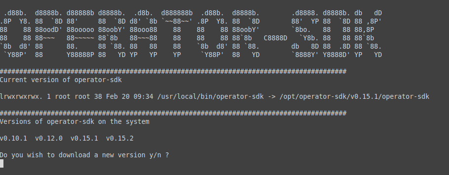
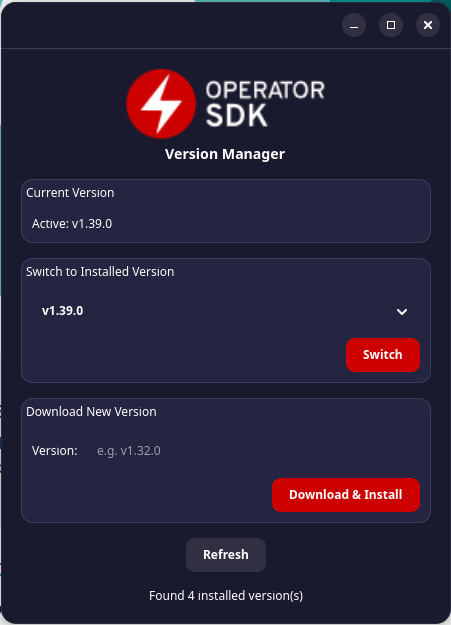

# Change the Operator-sdk binary

Shell script for downloading and changing the operator-sdk binary so you can manage multiple binaries locally. Symlinks to `/usr/local/bin/operator-sdk` from `/opt/operator-sdk/<version>/operator-sdk`. Should work with Linux and Mac.

> *NOTE*: This script doesn't verify the operator-sdk binary. Haven't tested on Mac.

## Usage (Command Line)

```sh
# Clone the Repo
git clone https://github.com/austincunningham/change-operator-sdk.git
# Change directory 
cd change-operator-sdk
# Set the file to be able to execute
chmod +x choperator-sdk.sh 
# Run the script (interactive mode)
./choperator-sdk.sh
# If you have versions of the operator-sdk on the system installed by this tool you can pass it in with cmd line args
./choperator-sdk.sh v1.12.0
# Direct download mode (non-interactive) - downloads and installs a new version
./choperator-sdk.sh -d v1.32.0
```



## GUI Application

A GTK4/libadwaita GUI is also available for managing Operator SDK versions.

### Requirements

- Python 3
- GTK 4
- libadwaita

On Fedora:
```sh
sudo dnf install python3 gtk4 libadwaita
```

On Ubuntu/Debian:
```sh
sudo apt install python3 python3-gi gir1.2-gtk-4.0 gir1.2-adw-1
```

### Running the GUI

```sh
python3 main.py
```

### Installing to Desktop (Cinnamon/GNOME/etc.)

To add the app to your application menu:

```sh
# Copy the desktop file
cp com.austincunningham.operatorsdk.desktop ~/.local/share/applications/

# Make it executable
chmod +x ~/.local/share/applications/com.austincunningham.operatorsdk.desktop
```

Then find "Operator SDK Switcher" in your application menu.



